<!--
  AAKASH.EXE // profile README
  You're reading the source, so here's the tour: every graphic on this page is a hand-written
  SVG animated with plain CSS. No JavaScript, no third-party widgets. The activity card and the
  snake are rebuilt daily by .github/workflows/profile-assets.yml.
  The robot in the footer is unit-553. It blinks. That's its whole job.
-->

<a href="https://aakashmunawar.com"></a>

  <a href="https://aakashmunawar.com"><b>aakashmunawar.com</b></a> &nbsp;·&nbsp;
  <a href="https://www.linkedin.com/in/aakash-munawar-760019268">LinkedIn</a> &nbsp;·&nbsp;
  <a href="mailto:aakashmunawar.dev@gmail.com">Email</a> &nbsp;·&nbsp;
  <a href="#projects">Projects</a> &nbsp;·&nbsp;
  <a href="https://trialwright.tech">Pre-Flight live demo</a>

## 🏆 HackRU 2026 — Best Regeneron Entry Winner

<a href="https://trialwright.tech"></a>

At HackRU 2026, my team built **Protocol Pre-Flight**, an AI-powered tool that reviews clinical trial protocols before a trial starts. It won the **Best Regeneron Entry** award.

Changing a protocol after a trial starts is expensive, and [many of those amendments are avoidable](https://pubmed.ncbi.nlm.nih.gov/30227022/). Pre-Flight looks for the problems early: missing required sections, numbers or rules that contradict each other across sections, heavy patient burden, and anything else a person should check. Every finding points to the page that supports it, and an AI finding is dropped unless the text it quotes is actually on the page it cites. A person accepts or rejects each finding.

- **My part:** I built the Next.js and TypeScript frontend, which is the upload page and the PDF review workspace where each finding is highlighted on the page it cites. I also built the typed API layer that connects the frontend to the team's FastAPI backend.
- **Team:** [Yash Lalwani](https://github.com/Yash-Lalwani), [Hanumath Mandadi](https://github.com/Hanumath1506) and me.
- **Stack:** `Next.js` `React` `TypeScript` `Tailwind CSS` `Python` `FastAPI` `PyMuPDF`

**[Live demo → trialwright.tech](https://trialwright.tech)** &nbsp;·&nbsp; **[Source code (TrialWright repo)](https://github.com/Yash-Lalwani/TrialWright)**

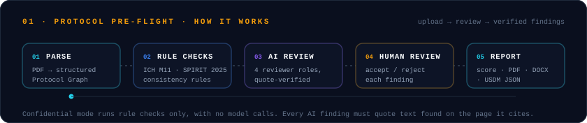

## About


I'm a Computer Science student at **Rutgers University–New Brunswick**. I started my CS coursework at Raritan Valley Community College before transferring. I'm most interested in full-stack development, artificial intelligence and data science.

I like building complete applications: designing the database, writing the backend API, building the interface, and working out the algorithm in between. So far that has meant a Spring Boot app with JWT authentication, a SQL dashboard over nearly 480,000 public records, and graph and backtracking algorithms written from scratch. At HackRU 2026, my team won Best Regeneron Entry for Protocol Pre-Flight.

I'm still early in AI and machine learning, and I learn something new with every project. I'm looking for internships, research and collaborative projects where I can keep building.

## Projects

<a href="https://github.com/Aakash553-stack/aakashmunawar-site/tree/master/projects/study-group-matcher"></a>

**Study Group Matcher** &nbsp;·&nbsp; [Live demo](https://study.aakashmunawar.com) (one-click "Try the demo") &nbsp;·&nbsp; [Source](https://github.com/Aakash553-stack/aakashmunawar-site/tree/master/projects/study-group-matcher) 
**Problem:** finding classmates who take the same courses and are free at the same times. 
**How it works:** a Spring Boot REST API with Spring Security and JWT authentication, PostgreSQL through JPA with Flyway migrations, and a plain HTML, CSS and JavaScript frontend where students paint their free time on a weekly grid. 
**Highlight:** the matching algorithm is written from scratch and checked against a brute-force model, with 41 passing JUnit tests. The public demo account runs in a separate sandbox, so a demo login never shows real students' names or schedules.

`Java` `Spring Boot` `Spring Security` `JWT` `PostgreSQL` `JPA` `Flyway` `JUnit`

<a href="https://github.com/Aakash553-stack/aakashmunawar-site/tree/master/projects/crime-data-explorer"></a>

**Chicago Crime Explorer** &nbsp;·&nbsp; [Live dashboard](https://crime.aakashmunawar.com) &nbsp;·&nbsp; [Source](https://github.com/Aakash553-stack/aakashmunawar-site/tree/master/projects/crime-data-explorer) 
**Problem:** making two years of public crime data explorable without writing SQL. 
**How it works:** 478,089 Chicago Police Department incident reports from the City of Chicago Data Portal, loaded into a normalized SQLite schema. A FastAPI backend serves six analyses to a Chart.js dashboard with filters for date, category, district, community area, arrests and domestic incidents. 
**Highlight:** the backend doesn't duplicate the analysis. It runs the same `queries.sql` file as the Jupyter notebook and adds filters to each query.

`Python` `SQL` `SQLite` `FastAPI` `pandas` `Jupyter` `matplotlib` `Chart.js`

<a href="https://github.com/Aakash553-stack/aakashmunawar-site/tree/master/projects/schedule-builder"></a>

**Schedule Builder** &nbsp;·&nbsp; [Source](https://github.com/Aakash553-stack/aakashmunawar-site/tree/master/projects/schedule-builder) 
**Problem:** five courses with several sections each can add up to over two million possible schedules, far too many to check by hand. 
**How it works:** a command-line tool over real Rutgers Fall 2026 section data (1,110 sections across 148 CS and Math courses). A backtracking search drops a partial schedule as soon as it has a time conflict, then ranks the results by days on campus, gaps between classes, later mornings or campus switches. 
**Highlight:** on a 5-course search, backtracking skips 87% of the 2.26 million combinations and runs 5.9× faster than brute force (2.0 s vs. 11.5 s).

`Python` `Backtracking` `Standard library only`

<a href="https://github.com/Aakash553-stack/aakashmunawar-site/tree/master/projects/campus-route-finder"></a>

**Campus Route Finder** &nbsp;·&nbsp; [Source](https://github.com/Aakash553-stack/aakashmunawar-site/tree/master/projects/campus-route-finder) 
**Problem:** finding the shortest walk between buildings on a campus split by the Raritan River. 
**How it works:** a graph of 24 real campus locations plus a bridge waypoint, with Dijkstra's algorithm and a binary-heap priority queue both written from scratch. It can also find the nearest locations of a type, such as the three closest dining halls, and draw the route on a map. 
**Highlight:** every coordinate comes from OpenStreetMap and keeps its OSM ID, so any location can be checked on the map.

`Python` `Graph algorithms` `Dijkstra` `unittest` `matplotlib`

<a href="https://github.com/Aakash553-stack/opstrack-police-operations-platform"></a>

**OpsTrack** *(in progress)* &nbsp;·&nbsp; [Source](https://github.com/Aakash553-stack/opstrack-police-operations-platform) 
**Problem:** an internal operations system with complex relationships and rules: officers, units, assignments, patrols and incidents. All data is fictional. 
**Done so far:** a hand-written 3NF PostgreSQL schema with 13 tables, Alembic migrations, and a FastAPI REST API for all 13 resources. Authentication, a full test suite and the React frontend are next. 
**Highlight:** the Alembic migration reproduces the hand-written schema exactly (verified with a `pg_dump` diff), and database rule violations come back from the API as clear `409 Conflict` errors.

`Python` `FastAPI` `PostgreSQL` `SQLAlchemy` `Alembic` `Docker`

<b>Earlier projects</b>

 

- [Task Manager REST API](https://github.com/Aakash553-stack/taskmanager): a task management REST API with Spring Boot and an in-memory H2 database.
- [Student Grade Tracker](https://github.com/Aakash553-stack/StudentGradeTracker): a Java Swing desktop app for grades, class averages and letter grades.
- [Bank Account Simulator](https://github.com/Aakash553-stack/BankAccountSimulator): a command-line Java banking simulator with overdraft protection.

## Tech I've Built With

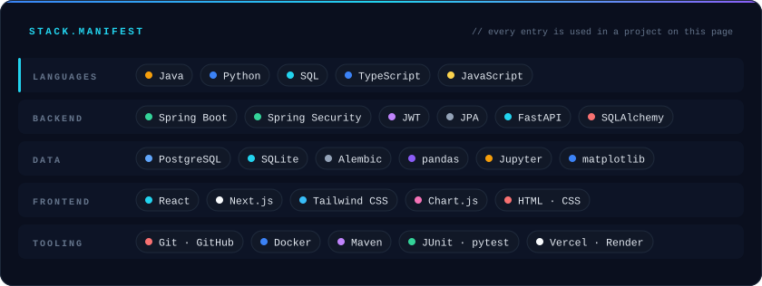

<b>Where each one shows up</b>

 

| Area | Tools | Used in |
|---|---|---|
| Java backend | Java, Spring Boot, Spring Security, JWT, JPA, Flyway, Maven, JUnit | Study Group Matcher, Task Manager API |
| Python backend | Python, FastAPI, SQLAlchemy, Alembic, pytest | OpsTrack, Chicago Crime Explorer |
| Databases | PostgreSQL, SQLite, SQL | Study Group Matcher, OpsTrack, Chicago Crime Explorer |
| Data analysis | pandas, Jupyter, matplotlib | Chicago Crime Explorer, Campus Route Finder |
| Frontend | TypeScript, React, Next.js, Tailwind CSS | Protocol Pre-Flight |
| Frontend | JavaScript, HTML, CSS, Chart.js | Study Group Matcher, Chicago Crime Explorer |
| Algorithms | Backtracking, Dijkstra, binary heaps | Schedule Builder, Campus Route Finder |
| Shipping | Git, GitHub, Docker, Vercel, Render | Version control everywhere; Docker for OpsTrack and Study Group Matcher; live demos on Vercel and Render |

## Currently Exploring


I'm learning these areas through coursework and projects. I'm not claiming expertise in them yet, but each new project usually goes a bit further into one of them.

## GitHub Activity

<picture>
  <source media="(prefers-color-scheme: dark)" srcset="https://raw.githubusercontent.com/Aakash553-stack/Aakash553-stack/output/snake-dark.svg">
  <source media="(prefers-color-scheme: light)" srcset="https://raw.githubusercontent.com/Aakash553-stack/Aakash553-stack/output/snake-light.svg">
  
</picture>

## Let's Connect & Build Something

I'm always glad to meet other developers, learn from people further along, and work on interesting projects together. Whether you're a student, engineer, researcher or recruiter, feel free to reach out.

**Open to:** internships · collaboration · research opportunities · learning opportunities · connecting with other developers

  
  
  
  

<code>aakashmunawar.dev@gmail.com</code>

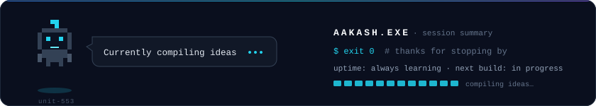
